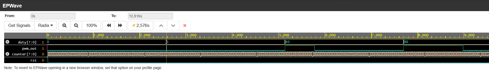

# verilog-pwm-controller

8-bit PWM generator in Verilog with a self-checking testbench.

## How it works
An 8-bit counter sweeps 0 to 255 and wraps. The output `pwm_out` is high
while `counter < duty`, so `duty` sets how long the output stays on each
256-cycle period (duty = 64 gives 25%).

## Files
- `pwm.v`: design (counter, synchronous active-high reset, comparator)
- `pwm_tb.v`: self-checking testbench

## Run it
iverilog -g2012 -o pwm_sim pwm.v pwm_tb.v
vvp pwm_sim

Expected output:
PASS duty=0
PASS duty=1
PASS duty=64
PASS duty=128
PASS duty=255

## Testbench
Counts high cycles over one full 256-cycle period and compares against
the expected count:
- duty = 0: never high (0 of 256)
- duty = 1: 1 of 256
- duty = 64: 64 of 256 (25%)
- duty = 128: 128 of 256 (50%)
- duty = 255: 255 of 256 (see design note)

## Waveform

Pulse width doubles from duty = 64 to 128 (25% to 50%).

## Design note
The output is high while `counter < duty`. At duty = 255 the counter still
reaches 255 once per period, where 255 < 255 is false, so the output dips
low for one cycle. Max duty is 255/256 (about 99.6%), never a constant 1.
Using `<=` instead would fix the top end but make duty = 0 emit one high
cycle, so true 0% and 100% would need special-casing.
